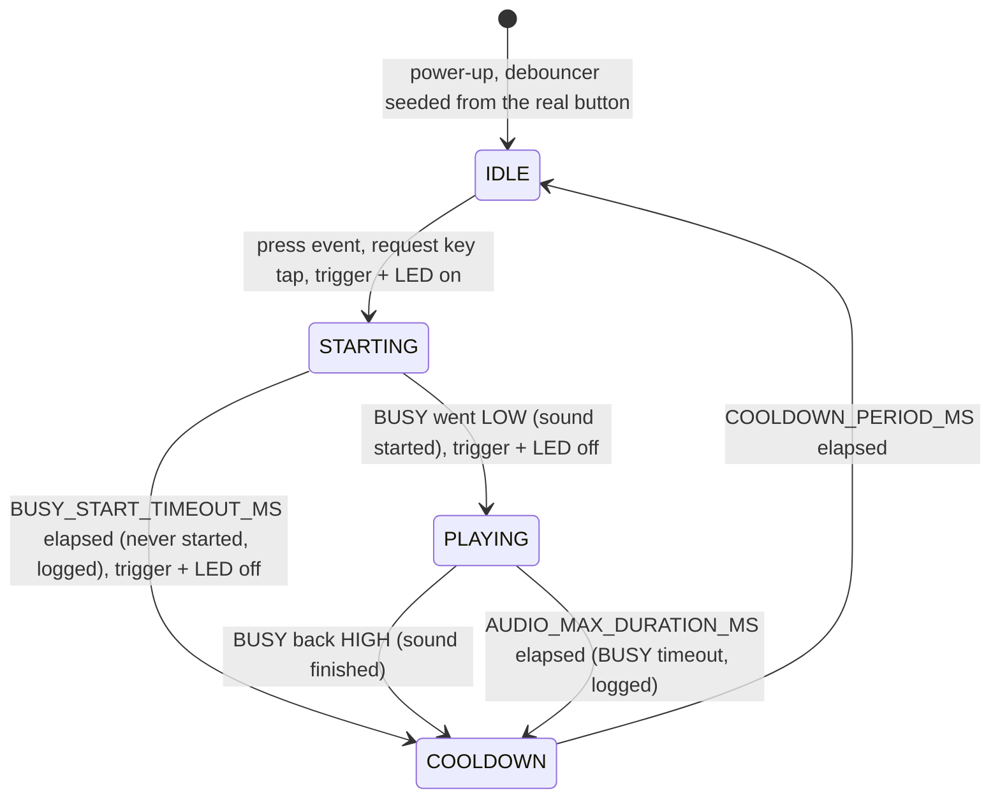

# MAL trigger firmware

Firmware for the SparkFun Pro Micro RP2040. A visitor presses a button and the board:

- types one key over USB, which starts a video on a BrightSign LS5
- pulses the trigger input of a DY-HV20T sound module, which starts a sound

Every exhibit pairs the BrightSign with the sound module, so the module's BUSY line decides when a playback is over. Presses are ignored until the sound finishes, and a held button triggers only once.

**Status:** the USB key tap is verified on macOS and on a BrightSign LS5 (a keyboard event in the presentation starts the video). The sound-module trigger and the BUSY lockout are implemented.

## Hardware

Board: SparkFun Pro Micro RP2040 (`PICO_BOARD=sparkfun_promicro`).

| Signal        | GPIO       | Notes                                                                                                       |
| ------------- | ---------- | ----------------------------------------------------------------------------------------------------------- |
| Button        | 26 (A0)    | Active low: button to GND with an external pull-up. The internal pulls are disabled in firmware.            |
| Trigger LED   | 2          | External LED that visualizes the trigger pulse: the firmware turns it on and off together with the sound trigger pin. The board has no plain LED: GPIO 25 drives its WS2812. |
| Sound trigger | 3          | Drives a BC547 that pulls the module's TRIG0 low (see below). GPIO HIGH = sound triggered.                  |
| Sound BUSY    | 4          | From the module: LOW while a sound plays, HIGH when idle. Internal pull-down (see below).                   |
| Debug UART    | 0 TX, 1 RX | `printf` output, 115200 baud, through a USB-to-UART adapter                                                |
| USB-C         |            | Reserved for the USB HID keyboard. There is no USB serial port.                                             |

### Sound module wiring

The module's trigger inputs are active low and pulled up inside the module. Connecting one straight to a GPIO caused false triggers: while the RP2040 was unpowered or booting, its pin's protection diodes pulled the line low. A transistor between them prevents that:

```
GPIO3 ──4.7k──┬──► B   BC547
              │        C ──── TRIG0 (pulled up inside the module)
             10k       E ──── GND (shared by the MCU and the module)
              │
             GND
```

- The module only sees an open transistor unless the GPIO actively drives the base. With the MCU off, the 10k holds the base low, so TRIG0 stays high.
- About 0.5 mA of base current saturates the BC547 for the small current the module's pull-up needs.
- The transistor inverts, so `trigger_sound(true)` (GPIO HIGH) means TRIG0 LOW, which triggers the sound.
- The emitter ground must be shared with the module's ground.

BUSY connects straight to GPIO 4. Check with a multimeter that it idles at 3.3 V or less, since RP2040 pins aren't 5 V tolerant. A 1k–4.7k series resistor keeps a powered module from back-powering an unpowered RP2040 through the pin.

## How it works

Every pass of the main loop does the same things, in the same order, and never waits:

```
tud_task() + key_tap.update()  →  read clock + button  →  debouncer.update()  →  state machine  →  key / sound / LED / printf
       (service USB)                    (sense)               (clean up)           (decide)               (act)
```

### Playback state machine



Presses in STARTING, PLAYING and COOLDOWN are logged and ignored.

- **Why STARTING exists:** BUSY is HIGH both before a sound starts and after it ends. The module takes a moment to start a sound from idle, so a check that only asked "is BUSY HIGH?" ended playback before the sound had begun, and the button rearmed mid-sound. STARTING waits for BUSY to go LOW first; PLAYING then waits for it to go HIGH again.
- **Trigger handshake:** the trigger is held until the module confirms it started (BUSY LOW), then released. There is no fixed pulse length to tune: the pulse is always exactly as long as the module needs.
- **BUSY lockout:** playback lasts until BUSY reports idle, so the sound's length sets the lockout for the video too. Make each sound at least as long as its video, or visitors can restart the video once the sound ends.
- **Timeouts:** anything the firmware waits on from outside the board has a time limit. `BUSY_START_TIMEOUT_MS` covers a sound that never starts (missing file, module fault) and makes sure the trigger is released. `AUDIO_MAX_DURATION_MS` covers BUSY never reporting idle (module unpowered, loose wire, frozen module). Both log a warning.
- **Failure mode:** BUSY has the RP2040's weak (~50 kΩ) internal pull-down. A powered module drives the line and overrides it; the pull only decides the reading when nothing drives BUSY (module unpowered, unplugged, loose wire). Then BUSY reads LOW ("busy"): STARTING moves straight to PLAYING, and the exhibit keeps working with a full `AUDIO_MAX_DURATION_MS` lockout and a warning in the log for each press. With a pull-up, a missing module would read as "idle" and each press would rearm after about `BUSY_START_TIMEOUT_MS`, letting visitors restart the video every second.
- **Cooldown:** a short `COOLDOWN_PERIOD_MS` pause before the button rearms.

The debouncer is updated on every pass in every state, so a press during playback is used up immediately instead of starting another playback when this one ends.

### Debouncing

```
                  press + bounces                 release + bounces
raw       __________|‾|_|‾|_|‾‾‾‾‾‾‾‾‾‾‾‾‾‾‾‾‾‾‾‾‾‾‾‾‾|_|‾|_____________
                    ^ ^ ^ ^ ^                         ^ ^ ^
                            ├───────┤                     ├───────┤
                              20 ms                         20 ms
stable    __________________________|‾‾‾‾‾‾‾‾‾‾‾‾‾‾‾‾‾‾‾‾‾‾‾‾‾‾‾‾‾|_____
                                    ▲                             ▲
                              true (press)                  false (release)
update()  __________________________|‾|_________________________________
                                    ▲                             ▲
                              true only during press        false elsewhere and upon release
```

Every change in the raw reading restarts a stopwatch, so bounces are never accepted. Once the reading has been steady for `DEBOUNCE_MS`, it becomes the stable state. `update()` returns true only on the pass where the stable state becomes pressed, which makes it an event rather than a state: holding the button produces one press, not a stream of them.

### USB key tap

A key tap is two keyboard messages: "key is down", then "nothing is down". If the second one is lost, the computer auto-repeats the key. The board can only hold one message until the computer picks it up (within 10 ms), so `KeyTap` sends them one at a time without waiting:

```
IDLE ──request()──► SEND_PRESS ──mailbox free──► SEND_RELEASE ──mailbox free──► IDLE
```

`tud_task()` runs first in every pass, then `key_tap.update()`. If the board isn't connected to a computer when the button is pressed, the key is dropped and logged rather than queued: a video starting long after the visitor walked away is worse than none. The sound still plays.

## Files

| File                    | Contents                                                                                                                 |
| ----------------------- | ------------------------------------------------------------------------------------------------------------------------ |
| `src/main.cpp`          | Pin setup, hardware helpers, USB callbacks and the playback state machine                                                |
| `src/debouncer.h`       | The `Debouncer` class. Pure logic with no Pico SDK calls, so it can be reused for other inputs and tested on a computer. |
| `src/key_tap.h`         | The `KeyTap` class: sends one key press + release over USB without blocking the main loop                                |
| `src/tusb_config.h`     | TinyUSB's compile-time configuration: device mode, one HID keyboard interface                                            |
| `src/usb_descriptors.c` | What the board tells the computer when plugged in: IDs, keyboard layout, names and serial number                         |
| `CMakeLists.txt`        | Build configuration, in numbered sections that follow the configure → compile → link flow                                |

## Configuration

All in the CONFIGURATION section at the top of `src/main.cpp`.

| Constant                | Default     | Meaning                                                                         |
| ----------------------- | ----------- | ------------------------------------------------------------------------------- |
| `DEBOUNCE_MS`           | 20          | How long the raw button reading must be steady before it is accepted            |
| `BUSY_START_TIMEOUT_MS` | 1000        | How long to hold the trigger waiting for BUSY to go LOW before giving up       |
| `AUDIO_MAX_DURATION_MS` | 7000        | Safety limit on one playback if BUSY never reports idle. Longer than the longest sound |
| `COOLDOWN_PERIOD_MS`    | 100         | Pause after a playback before the button rearms                                 |
| `TRIGGER_KEY`           | `HID_KEY_A` | Key sent on each press; match it in the BrightSign presentation's keyboard event |
| `BUTTON_PIN`            | 26          | GPIO numbers                                                                    |
| `LED_TRIGGER_PIN`       | 2           |                                                                                 |
| `SOUND_TRIGGER_PIN`     | 3           |                                                                                 |
| `SOUND_BUSY_PIN`        | 4           |                                                                                 |

## Build

```zsh
cmake -S . -B build -G Ninja -DPICO_BOARD=sparkfun_promicro
cmake --build build
```

The `.uf2` is named after the project in `CMakeLists.txt`: `build/MAL-trigger-firmware.uf2`.

## Flash

The USB port belongs to the HID keyboard, so this firmware has no USB serial port, and `picotool load -f` can't reboot the board for you. Put it into BOOTSEL mode by hand:

1. Hold **BOOT**, tap **RESET**, then release **BOOT**. (Or hold **BOOT** while plugging in USB.)
2. Load and run:

```zsh
picotool load -x build/MAL-trigger-firmware.uf2
```

`-x` starts the new firmware right after loading. To make sure you never flash a stale build, build and flash in one command (`&&` only flashes if the build succeeded):

```zsh
cmake --build build && picotool load -x build/MAL-trigger-firmware.uf2
```

 To check which firmware is on a board, put it in BOOTSEL mode and run `picotool info`: it shows the program name and version set in `CMakeLists.txt`.

## Debug output

`printf` goes to UART0 only. Connect a 3.3 V USB-to-UART adapter (adapter RX → GPIO 0 TX, adapter TX → GPIO 1 RX, GND → GND), then:

```zsh
tio -b 115200 /dev/tty.usbserial-*
```

The device name depends on the adapter; `ls /dev/tty.*` lists the options.

## Tests to run after changes

For key tests on a computer, open TextEdit and click into an empty document first: the board types wherever the cursor is. On the exhibit, watch the BrightSign and listen to the sound module instead.

| Test                                   | Expected                                                                              |
| -------------------------------------- | ------------------------------------------------------------------------------------- |
| One press                              | Exactly one `a` (or one video start) and one sound; the button rearms when the sound ends |
| Hold the button for 12 s               | Exactly one playback and one `a`, with no auto-repeat                                 |
| Tap during the sound                   | Logged as ignored; no extra `a`; video and sound continue                             |
| Tap during the **first** sound after idle | Same as above. (Regression test: this once retriggered, before the STARTING state)  |
| Press, wait for the sound to end, press | Two playbacks (`aa`)                                                                 |
| Power up with the button held          | Nothing until the button is released and pressed again                                |
| Bare jumper wire tapped to GND         | One press per tap                                                                     |
| Power up with everything off           | No sound triggers on its own while the boards start                                   |
| Disconnect the sound module, press     | Key still sent; `WARNING: BUSY line timed out` after `AUDIO_MAX_DURATION_MS`; button then rearms |
| Press repeatedly while the LS5 boots   | No late video once it finishes booting                                                |
| Unplug and replug USB-C, press         | Works again with no reset                                                             |
