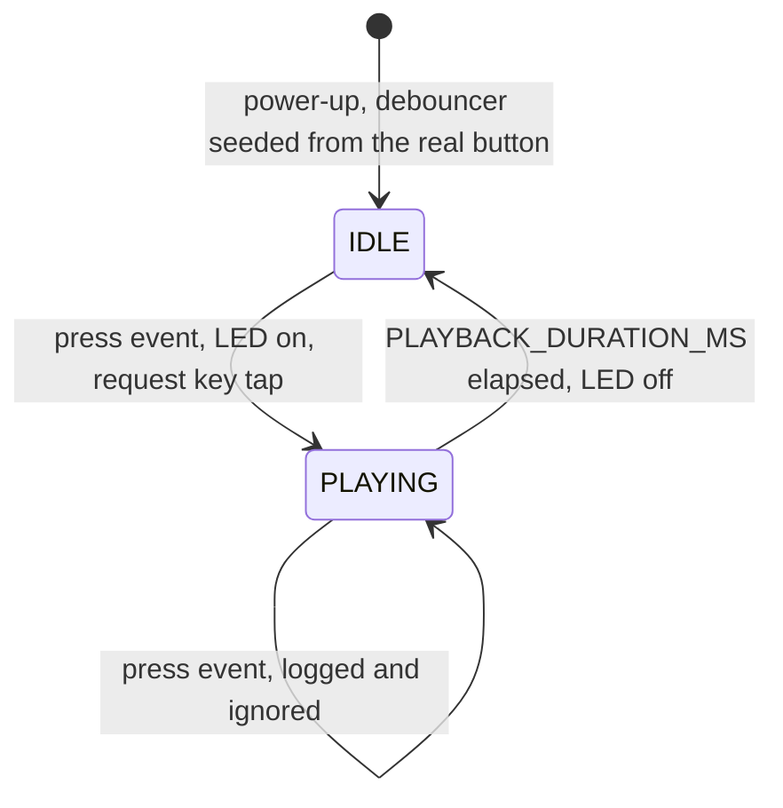

# MAL trigger firmware

Firmware for the SparkFun Pro Micro RP2040. A visitor presses a button and the board types one key over USB, which triggers video playback on a BrightSign LS5. It also starts a timed playback window, shown on the status LED. Presses during playback are ignored, and a held button triggers only once.

**Status:** one button press sends one key tap (`TRIGGER_KEY`) as a USB HID keyboard ("MAL Trigger Controller"). Verified on macOS; not yet tested on the BrightSign LS5. The sound-module output is not implemented yet.

## Hardware

Board: SparkFun Pro Micro RP2040 (`PICO_BOARD=sparkfun_promicro`).

| Signal     | GPIO       | Notes                                                                                            |
| ---------- | ---------- | ------------------------------------------------------------------------------------------------ |
| Button     | 26 (A0)    | Active low: button to GND with an external pull-up. The internal pulls are disabled in firmware. |
| Status LED | 4          | External LED. The board has no plain LED: GPIO 25 drives its WS2812.                             |
| Debug UART | 0 TX, 1 RX | `printf` output, 115200 baud, through a USB-to-UART adapter                                     |
| USB-C      |            | Reserved for the USB HID keyboard. There is no USB serial port.                                  |

## How it works

Every pass of the main loop does the same three things, and never waits:

```
read clock + button  →  debouncer.update()  →  state machine  →  LED / printf
     (sense)                (clean up)            (decide)          (act)
```

### Playback state machine



The debouncer is updated on every pass in both states, so a press during playback is used up immediately instead of starting another playback when this one ends.

### Debouncing

```
                  press + bounces                 release + bounces
raw       __________|‾|_|‾|_|‾‾‾‾‾‾‾‾‾‾‾‾‾‾‾‾‾‾‾‾‾‾‾‾‾|_|‾|_____________
                    ^ ^ ^ ^ ^                         ^ ^ ^
                            ├───────┤                     ├───────┤
                              20 ms                         20 ms
stable    __________________________|‾‾‾‾‾‾‾‾‾‾‾‾‾‾‾‾‾‾‾‾‾‾‾‾‾‾‾‾‾|_____
                                    ▲                             ▲
                              true (press)                  false (release)
update()  __________________________|‾|_________________________________
                                    ▲                             ▲
                              true only during press        false elsewhere and upon release
```

Every change in the raw reading restarts a stopwatch, so bounces are never accepted. Once the reading has been steady for `DEBOUNCE_MS`, it becomes the stable state. `update()` returns true only on the pass where the stable state becomes pressed, which makes it an event rather than a state: holding the button produces one press, not a stream of them.

### USB key tap

A key tap is two keyboard messages: "key is down", then "nothing is down". If the second one is lost, the computer auto-repeats the key. The board can only hold one message until the computer picks it up (within 10 ms), so `KeyTap` sends them one at a time without waiting:

```
IDLE ──request()──► SEND_PRESS ──mailbox free──► SEND_RELEASE ──mailbox free──► IDLE
```

`tud_task()` runs first in every pass, then `key_tap.update()`. If the board isn't connected to a computer when the button is pressed, the key is dropped and logged rather than queued: a video starting long after the visitor walked away is worse than none.

## Files

| File                | Contents                                                                                                                 |
| ------------------- | ------------------------------------------------------------------------------------------------------------------------ |
| `src/main.cpp`      | Pin setup, hardware helpers and the playback state machine                                                               |
| `src/debouncer.h`   | The `Debouncer` class. Pure logic with no Pico SDK calls, so it can be reused for other inputs and tested on a computer. |
| `src/key_tap.h`     | The `KeyTap` class: sends one key press + release over USB without blocking the main loop                                |
| `src/tusb_config.h` | TinyUSB's compile-time configuration: device mode, one HID keyboard interface                                            |
| `src/usb_descriptors.c` | What the board tells the computer when plugged in: IDs, keyboard layout, names and serial number                     |
| `CMakeLists.txt`    | Build configuration, in numbered sections that follow the configure → compile → link flow                                |

## Configuration

| Constant                       | Default | Meaning                                                       |
| ------------------------------ | ------- | ------------------------------------------------------------- |
| `DEBOUNCE_MS`                  | 20      | How long the raw reading must be steady before it is accepted |
| `PLAYBACK_DURATION_MS`         | 5000    | How long each playback lasts                                  |
| `BUTTON_PIN`, `STATUS_LED_PIN` | 26, 4   | GPIO numbers                                                  |
| `TRIGGER_KEY`                  | `HID_KEY_A` | Key sent on each press; match it in the BrightSign presentation's keyboard event |

## Build

```zsh
cmake -S . -B build -G Ninja -DPICO_BOARD=sparkfun_promicro
cmake --build build
```

The `.uf2` is named after the project in `CMakeLists.txt`: `build/MAL-trigger-firmware.uf2`.

## Flash

The USB port belongs to the HID keyboard, so this firmware has no USB serial port, and `picotool load -f` can't reboot the board for you. Put it into BOOTSEL mode by hand:

1. Hold **BOOT**, tap **RESET**, then release **BOOT**. (Or hold **BOOT** while plugging in USB.)
2. Load and run:

```zsh
picotool load -x build/MAL-trigger-firmware.uf2
```

`-x` starts the new firmware right after loading. To check which firmware is on a board, put it in BOOTSEL mode and run `picotool info`: it shows the program name and version set in `CMakeLists.txt`.

## Debug output

`printf` goes to UART0 only. Connect a 3.3 V USB-to-UART adapter (adapter RX → GPIO 0 TX, adapter TX → GPIO 1 RX, GND → GND), then:

```zsh
tio -b 115200 /dev/tty.usbserial-*
```

The device name depends on the adapter; `ls /dev/tty.*` lists the options.

## Tests to run after changes

Open TextEdit and click into an empty document first: the board types wherever the cursor is.

| Test                           | Expected                                                            |
| ------------------------------ | ------------------------------------------------------------------- |
| One press                      | One 5 s playback and exactly one `a` typed; then the button works again |
| Hold the button for 12 s       | Exactly one playback and one `a`, with no auto-repeat               |
| Tap during playback            | Logged as ignored; no extra `a`; playback is unaffected             |
| Press, wait for the end, press | `aa`                                                                |
| Power up with the button held  | Nothing until the button is released and pressed again              |
| Bare jumper wire tapped to GND | One press per tap                                                   |
